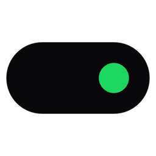
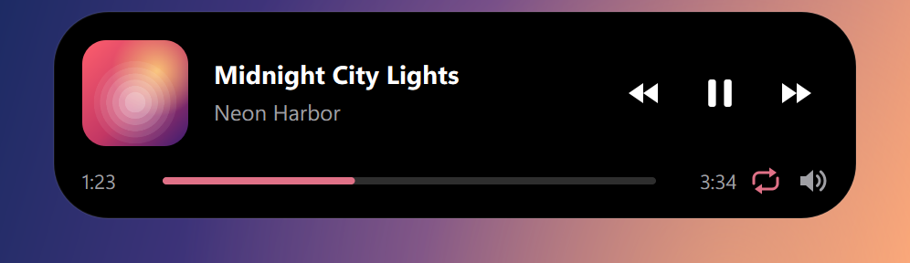
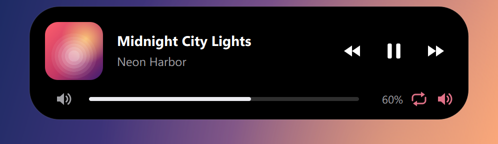

<div align="center">



# Dynamic Island для Windows

**Капсула в стиле iPhone Dynamic Island по центру верхнего края экрана — с треком Spotify, обложкой и управлением музыкой.**

[](#)
[](https://www.python.org/)
[](https://doc.qt.io/qtforpython-6/)
[](#-подробно)
[](#-тесты)
[](LICENSE)


[**⬇ Скачать для Windows**](https://github.com/ScA1322/dynamic-island-windows/releases/latest) · [Возможности](#-возможности) · [Быстрый старт](#-быстрый-старт) · [Частые проблемы](#-частые-проблемы)

</div>

---

## ✨ Возможности

<table>
<tr>
<td width="50%" valign="top">

🎵 **Текущий трек Spotify** — название, исполнитель, обложка, прогресс. Работает сразу: без аккаунтов, ключей и Premium.

⏯ **Управление музыкой** — ⏮ ⏯ ⏭, перемотка по полосе прогресса, повтор плейлиста/трека.

🔊 **Громкость только Spotify** — колесом мыши или ползунком, системная громкость не трогается.

</td>
<td width="50%" valign="top">

🎮 **Прячется в играх** — эксклюзивный и безрамочный полноэкранный режим, F11, известные движки и лаунчеры.

🪄 **Плавные анимации** — «пружинистое» раскрытие, перетекание обложек, эквалайзер в цвет обложки.

🖱 **Не мешает** — клики проходят сквозь капсулу, она не забирает фокус и не появляется в Alt+Tab.

</td>
</tr>
</table>

<div align="center">
<table>
<tr>
<td align="center"><br><sub>Свёрнутая: обложка и эквалайзер</sub></td>
</tr>
<tr>
<td align="center"><br><sub>Раскрытая: управление, прогресс, повтор</sub></td>
</tr>
<tr>
<td align="center"><br><sub>Режим громкости</sub></td>
</tr>
</table>
</div>

## 🚀 Быстрый старт

#### Готовая сборка (Python не нужен)
Скачайте `DynamicIsland-windows.zip` со страницы [Releases](https://github.com/ScA1322/dynamic-island-windows/releases/latest), распакуйте и запустите `DynamicIsland.exe`. Если собирали сами, exe лежит в `dist\DynamicIsland\`. Папку с программой можно скопировать куда угодно (переносите **всю папку**, не только exe). Если включён автозапуск, после переноса откройте и сохраните настройки один раз: путь в реестре обновится автоматически при следующем старте.

#### Из исходников
```bat
setup.bat      :: создаёт .venv и ставит зависимости (нужен Python 3.12+)
start.bat      :: запуск без консоли
build.bat      :: тесты + сборка dist\DynamicIsland\DynamicIsland.exe
```
Запуск с логами в консоли: `.venv\Scripts\python.exe main.py --debug`.

После запуска появится иконка в трее (возможно, в скрытой области ^). Правый клик по ней открывает меню: показать/скрыть, настройки, Spotify Web API, игровой режим, автозапуск, выход. Левый клик открывает настройки. Повторный запуск приложения не создаёт второй экземпляр, а открывает настройки уже запущенного.

## 📖 Подробно

<details>
<summary><b>🎧 Spotify: SMTC и Web API</b></summary>
<br>

#### Основной источник: SMTC (настройка не нужна)
Windows System Media Transport Controls проверены на практике (Windows 11, десктопный Spotify). Spotify отдаёт через них **название, исполнителя, альбом, обложку (PNG), статус воспроизведения, позицию/длительность и команды next/previous/play/pause**. Поэтому всё работает сразу, без аккаунтов и ключей, без сетевых запросов и без Premium.

Ограничения SMTC:
- Spotify обновляет позицию трека только при событиях (пауза, перемотка, смена трека), поэтому прогресс между ними досчитывается локально. После перемотки он синхронизируется в течение ~2 секунд.
- Видна только музыка, играющая **на этом компьютере**. Другие плееры (браузер и т.п.) намеренно игнорируются.

#### Запасной источник: Spotify Web API (необязательно)
Нужен, только если Spotify играет на другом устройстве (телефон, колонка) и вы хотите видеть это в капсуле. Используется, только когда SMTC не видит Spotify.

1. Откройте https://developer.spotify.com/dashboard → **Create app**.
2. В **Redirect URIs** добавьте `http://127.0.0.1:8765/callback` (точное значение с кнопкой «Копировать» есть в Настройки → Spotify; порт можно сменить там же).
3. Отметьте **Web API** и сохраните. Скопируйте **Client ID**.
4. Настройки → Spotify → вставьте Client ID → **Подключить**. Откроется браузер, подтвердите доступ.

Также можно положить `SPOTIFY_CLIENT_ID=...` в файл `.env` рядом с `main.py` или exe (см. `.env.example`).

Подробности:
- Авторизация через Authorization Code + **PKCE**. Client secret не нужен и нигде не хранится.
- Запрашиваются только права `user-read-playback-state`, `user-read-currently-playing`, `user-modify-playback-state`.
- Токены лежат в `%APPDATA%\DynamicIsland\spotify_token.bin` и зашифрованы DPAPI (расшифровать может только ваша учётная запись Windows). В логах токены вырезаются.
- Опрос раз в 3 с при воспроизведении и раз в 8 с в паузе. При ошибке 429 соблюдается `Retry-After`, при сетевых ошибках интервал растёт до 60 с.
- **Управление воспроизведением через Web API требует Spotify Premium.** Без него кнопки покажут «требует Spotify Premium»; это не обходится. Через SMTC (локальный Spotify) кнопки работают без Premium.
- Если обновить токен не удалось (доступ отозван), капсула и настройки покажут «нужна повторная авторизация» → кнопка **Переподключить**.
- Spotify периодически меняет правила для приложений в режиме разработки. Если Dashboard не даёт создать приложение, Web API будет недоступен, а SMTC продолжит работать.

</details>

<details>
<summary><b>🎚 Перемотка, громкость и повтор</b></summary>
<br>

- **Перемотка:** клик по полосе прогресса или перетаскивание ползунка. Пока тянешь, время показывается заранее, а Spotify перематывается в момент отпускания. Работает через SMTC (без Premium); через Web API тоже, но там нужен Premium.
- **Повтор:** иконка 🔁 рядом с динамиком. По клику переключается как в Spotify: выкл → плейлист → трек. Серая — выключено, цвет обложки — повтор плейлиста, с «1» — повтор трека. Если режим сменить в самом Spotify, капсула это тоже покажет.
- **Громкость:** колесо мыши над раскрытой капсулой (5 % за щелчок) или иконка динамика справа от прогресса. По клику строка прогресса превращается в ползунок громкости и через 3 с бездействия возвращается обратно. Клик по левому динамику в этом режиме выключает и возвращает звук.
- Меняется громкость **только Spotify** (как ползунок Spotify в микшере Windows); системная громкость и другие программы не затрагиваются. Аудиосессия Spotify появляется после первого воспроизведения, поэтому до этого иконки громкости нет. При Web API (музыка на другом устройстве) меняется громкость того устройства, для этого нужен Premium.

</details>

<details>
<summary><b>🎮 Скрытие во время игр</b></summary>
<br>

Определение собирается из нескольких признаков, потому что ни один из них не надёжен сам по себе:

| Признак | Что ловит |
|---|---|
| `SHQueryUserNotificationState` = D3D fullscreen | эксклюзивный полноэкранный режим |
| окно покрывает весь монитор и не является обычным развёрнутым окном | безрамочный полноэкранный режим, F11 в браузере, видео |
| класс окна движка (Unity, Unreal, SDL, GLFW, Source…) или путь установки (`steamapps`, `Epic Games`, `Riot Games`, `XboxGames`, `\Games\`…) | «это игра» |
| список «Всегда считать игрой» | любые игры, в том числе оконные |
| список «Никогда не скрывать для» | исключения (например, видеоплеер) |

Как это работает:
- Проверка запускается по событию смены активного окна (WinEvent hook) и раз в секунду, чтобы поймать переключение F11. Нагрузка ничтожная.
- Скрытие мгновенное. Появление происходит, только если «показ» держится 0,6 с, поэтому при Alt+Tab ничего не мигает. Экраны Alt+Tab, «Представление задач» и меню «Пуск» решение не меняют.
- Рабочий стол, свёрнутая игра и обычные окна возвращают капсулу.
- Игры прячут капсулу на любом мониторе. Прочие полноэкранные приложения прячут её, только если они на том же мониторе.
- Музыка при скрытии не останавливается, приложение не завершается.
- Настройки → Игры → «Сейчас» показывает активный процесс и принятое решение. Это удобно для настройки списков.

**Ограничения.** Гарантировать распознавание любой игры невозможно. Игра в **окне** без признаков движка и не из известной папки не будет считаться игрой: добавьте её exe в «Всегда считать игрой». Если выключить «Скрывать в полноэкранных приложениях», безрамочные игры с неизвестными признаками тоже нужно добавлять в список. На крайний случай есть **игровой режим вручную** (трей → «Игровой режим»).

</details>

<details>
<summary><b>🪟 Поведение окна</b></summary>
<br>

- Одно окно постоянного размера без рамки, полупрозрачное, поверх других окон, без кнопки на панели задач и в Alt+Tab, никогда не забирает фокус. Анимация идёт внутри окна, окно не двигается и не меняет размер, поэтому нет рывков и мерцания.
- В свёрнутом состоянии окно полностью «прозрачно» для мыши (`WS_EX_TRANSPARENT`): клики проходят к окнам под ним. Когда курсор над капсулой, окно начинает принимать клики, чтобы кнопки работали. Курсор опрашивается раз в 150 мс (вблизи капсулы раз в 30 мс), без глобальных хуков клавиатуры и мыши. Во время игры опрос остановлен.
- Раскрытие занимает ~320 мс с лёгкой «пружиной», сворачивание ~260 мс. Перед сворачиванием выдерживается настраиваемая задержка (500 мс по умолчанию). Если курсор вернулся, сворачивание отменяется, в том числе посреди анимации.
- При смене трека обложка и текст плавно перетекают. Обложка плавно растёт из мини-версии. Цвет эквалайзера и полосы прогресса берётся из обложки.
- Учитывается масштабирование Windows (Qt per-monitor DPI). При смене разрешения, подключении и отключении мониторов окно перепозиционируется.

</details>

<details>
<summary><b>📁 Где хранятся данные</b></summary>
<br>

| Путь | Что |
|---|---|
| `%APPDATA%\DynamicIsland\settings.json` | настройки (повреждённый файл → `settings.json.bad` + значения по умолчанию) |
| `%APPDATA%\DynamicIsland\spotify_token.bin` | токены Web API (DPAPI) |
| `%LOCALAPPDATA%\DynamicIsland\covers` | кэш обложек (до 300 файлов, по хэшу содержимого или URL) |
| `%LOCALAPPDATA%\DynamicIsland\logs\dynamic_island.log` | лог (ротация 3×1 МБ) |
| `HKCU\Software\Microsoft\Windows\CurrentVersion\Run\DynamicIsland` | автозапуск (одно значение, права администратора не нужны) |

Телеметрии нет. Сеть используется только для запросов к `accounts.spotify.com`, `api.spotify.com` и CDN обложек Spotify, и только если подключён Web API.

</details>

<details>
<summary><b>🗂 Структура проекта</b></summary>
<br>

```
main.py                    точка входа: логирование, защита от второго экземпляра, --exit-after, --debug
app/application.py         связывает всё вместе; корректное завершение
app/island_window.py       окно: флаги Win32, позиционирование, click-through, наведение
app/island_widget.py       отрисовка капсулы и всех элементов (QPainter)
app/animations.py          AnimatedValue (QPropertyAnimation), HoverIntent (задержка сворачивания)
app/game_detector.py       логика скрытия (чистая функция evaluate) + Win32-проба + WinEvent hook
app/media/smtc.py          источник SMTC (QThread + asyncio + WinRT, события + редкий опрос)
app/media/spotify_api.py   Web API: PKCE, токены DPAPI, rate limit, рабочий поток
app/media/controller.py    выбор источника и маршрутизация команд
app/media/cover_cache.py   кэш обложек
app/settings_window.py     окно настроек;  app/system_tray.py  трей
app/media/volume.py        громкость Spotify через Core Audio (микшер Windows)
app/autostart.py           автозапуск;  app/single_instance.py  мьютекс + активация
app/config.py              настройки, валидация, пути;  app/logger.py  логи с вырезанием секретов
tests/                     pytest (114 тестов)
```

</details>

## 🧪 Тесты

```bat
.venv\Scripts\python.exe -m pytest
```
Покрыто: настройки (сохранение, загрузка, порча, валидация), раскрытие и сворачивание с отменой, обновление метаданных и пауза, отсутствие Spotify, переход на Web API, кэш обложек, ошибки API (401/refresh, отзыв токена, 429, 403 Premium, 404 нет устройства, 5xx, нет сети), OAuth-callback, шифрование токенов, вырезание секретов из логов, логика игр и полноэкранных окон (без GUI), скрытие и возврат оверлея, флаги окна и click-through, клик по кнопке, трей, автозапуск (на тестовом ключе реестра), второй экземпляр (в отдельном процессе), завершение потоков.

<details>
<summary><b>Ручная проверка (то, что не автоматизировано)</b></summary>
<br>

1. **Игра в эксклюзивном полноэкранном режиме:** запустите игру → капсула исчезает. Alt+Tab на рабочий стол → капсула возвращается через ~0,6 с. Вернитесь в игру → капсула снова скрыта.
2. **Безрамочная игра и F11 в браузере:** то же самое. Для оконной игры добавьте её в «Всегда считать игрой».
3. **Кнопки:** наведите курсор, нажмите ⏭ / ⏯ / ⏮ — Spotify реагирует.
4. **Web API:** закройте десктопный Spotify, включите музыку на телефоне, подключите Web API → капсула показывает трек с телефона.

</details>

## 🛠 Частые проблемы

| Симптом | Решение |
|---|---|
| Нет иконки в трее | Она в скрытой области (стрелка ^). Её можно закрепить в Параметры → Персонализация → Панель задач. |
| «Spotify не запущен», хотя он играет | Проверьте, что включён десктопный Spotify (не веб-плеер в браузере). В Spotify: Настройки → Отображение → «Показывать оверлей рабочего стола при использовании медиа-клавиш» должно быть включено, иначе Spotify может не регистрироваться в SMTC. Перезапустите Spotify. |
| Капсула не исчезает в игре | Настройки → Игры → «Сейчас» покажет процесс. Добавьте его в «Всегда считать игрой». |
| Капсула исчезает там, где не надо | Добавьте процесс в «Никогда не скрывать для» или выключите «Скрывать в полноэкранных приложениях». |
| «Порт 8765 занят» при подключении Web API | Смените порт в Настройки → Spotify и обновите Redirect URI в Dashboard. |
| `INVALID_CLIENT: Invalid redirect URI` | Redirect URI в Dashboard должен совпадать **символ в символ** (`http://127.0.0.1:<порт>/callback`; `localhost` Spotify не принимает). |
| Кнопки через Web API: «требует Spotify Premium» | Ограничение Spotify. Для бесплатного аккаунта управляйте локальным клиентом (SMTC). |
| Капсула не на том мониторе | Настройки → Общие → Монитор. |
| Что-то пошло не так | Смотрите `%LOCALAPPDATA%\DynamicIsland\logs\dynamic_island.log` или запустите `main.py --debug`. |
| Сброс всех настроек | Закройте приложение и удалите `%APPDATA%\DynamicIsland\settings.json`. |

## 📄 Лицензия

[MIT](LICENSE). Проект не связан со Spotify и Apple; названия принадлежат их владельцам.
